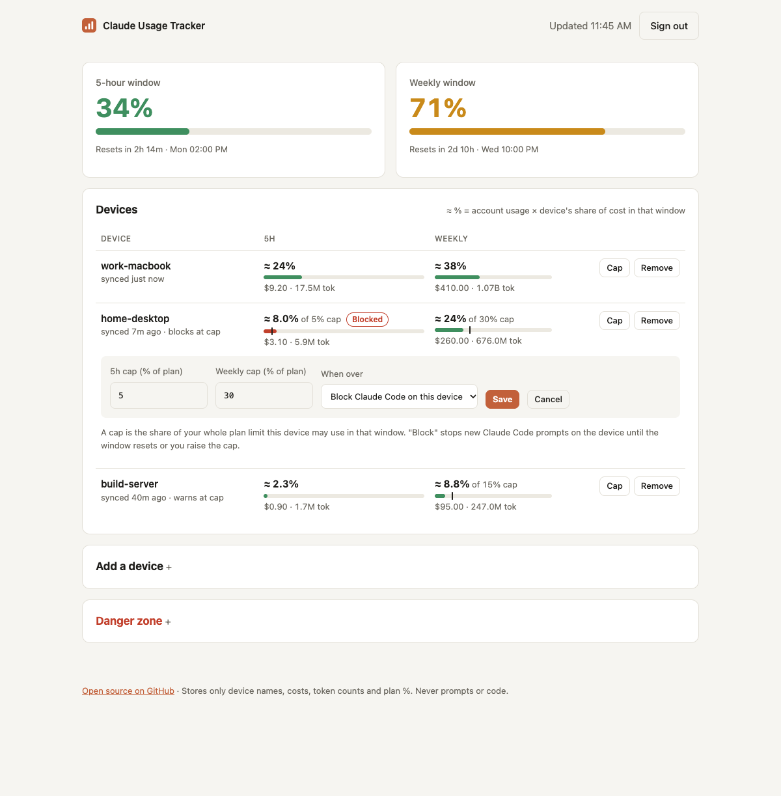

# Claude Usage Tracker

See how much of your **Claude 5-hour and weekly plan limits** each of your devices is using — laptop, desktop,
build server — from the terminal (`/usage-tracker:status` in Claude Code) or a web dashboard on your own server.



```text
/usage-tracker:status

Claude plan windows · device: work-macbook
  Window  Account (all devices)        Resets                This device
  5h      ███████░░░░░░░░░░░░░  34%    in 2h 26m (14:00)     $9.20 · 17.5M tok
  Weekly  ██████████████░░░░░░  71%    in 2d 10h (Wed 22:00) $410.00 · 1.07B tok

Per device · https://usage.example.com · % split by cost share
  Window  Device                ≈ % of limit  Cap       Cost       Tokens    Synced
  5h      work-macbook *        ≈ 23.9%       —         $9.20      17.5M     just now
          home-desktop          ≈ 8.0%        5% OVER   $3.10      5.9M      7m ago
          build-server          ≈ 2.3%        —         $0.90      1.7M      40m ago
  Weekly  work-macbook *        ≈ 38.4%       —         $410.00    1.07B     just now
          ...
```

It has two parts, both in this repo:

| Part | What it does |
|---|---|
| **Claude Code plugin** (`plugin/`) | Reads your plan usage and this device's local usage, reports it to your server in the background, and adds `/usage-tracker:status` and `/usage-tracker:setup`. |
| **Server + website** (`server/`) | Self-hosted (Docker / Coolify). People register on the website and get **one token**. Every device that uses that token is grouped under that one account. |

## How it works

| Number | Source |
|---|---|
| Account % and reset time | `GET https://api.anthropic.com/api/oauth/usage` with Claude Code's own OAuth login — the same data as `/usage` in Claude Code. It covers the whole account: every device, plus claude.ai chat. |
| This device's cost and tokens | [`ccusage`](https://github.com/ccusage/ccusage) `claude blocks --session-length 1`, summed over Anthropic's exact window (`resets_at − 5h` / `− 7d`). |
| Per-device ≈ % | `account % × device cost ÷ total cost of all devices` in the same window. **This is an estimate**: Anthropic only publishes one number per account, and chat usage on claude.ai gets spread across your devices. |

Devices report automatically: the plugin's `SessionStart` and `Stop` hooks push in the background, at most once
every 5 minutes. A device only appears once it has run Claude Code with the plugin installed.

**One token = one Claude account.** Put devices that log into the same Claude subscription under the same token.

## Per-device caps

On the website, click **Cap** next to a device to limit how much of your plan it may use. For example, cap
`home-desktop` at 20% of the 5-hour window and 30% of the weekly window.

- **Warn only** — the dashboard and `/usage-tracker:status` mark the device `OVER`.
- **Block Claude Code on this device** — the plugin's `UserPromptSubmit` hook refuses new prompts on that device
  while it is over its cap, explaining why and when the window resets. Raising or removing the cap on the website
  unblocks it within a minute, and blocking ends automatically when the window resets.

Caps are checked against the device's estimated share (above). A device starts being blocked at its next report
after going over: reports happen at most every 5 minutes while you use Claude Code. Checks run against locally
cached data, so they add no network delay to normal prompts. If the server can't be reached, the last known
verdict stays in effect until the window resets.

## Install the plugin (each device)

Requirements: Claude Code logged in with a Claude subscription (Pro/Max/Team — not an API key), and Node.js 18+.
`ccusage` is used if it's installed (`npm i -g ccusage`); otherwise it runs through `npx ccusage@20`.

```text
/plugin install usage-tracker --marketplace sherbaev/claude-usage-tracker
```

or, on older Claude Code:

```text
/plugin marketplace add sherbaev/claude-usage-tracker
/plugin install usage-tracker@claude-usage-tracker
```

Then connect the device to your server:

```text
/usage-tracker:setup https://usage.example.com cut_your_token
```

Claude asks for a device name — **give each device a different name** (`work-macbook`, `home-desktop`, …). You can
instead fill in the plugin options under `/plugin` → *usage-tracker* → *Configure options* (`server_url`, `token`,
`device_name`). Those take precedence, and the token is kept in your system's secure credential store.

To get a token, open your server URL in a browser and click **Create account**, or let `/usage-tracker:setup`
register for you. Use the **same token on every device**.

| Command | |
|---|---|
| `/usage-tracker:status` | Account 5h/weekly %, reset times, every device's share and cap |
| `/usage-tracker:setup [url] [token] [name]` | Connect this device |

### Optional: `ccusage claude daily` in your shell

```sh
git clone https://github.com/sherbaev/claude-usage-tracker && cd claude-usage-tracker && npm link   # adds `ccw`
```

```zsh
# ~/.zshrc — print the window panel after `ccusage claude daily`
ccusage() {
  command ccusage "$@" || return $?
  if [[ "$1" == claude && "$2" == daily && " ${*} " != *" --json "* && " ${*} " != *" -j "* ]]; then
    ccw || true
  fi
}
```

## Deploy the server (Coolify)

1. Coolify → **New Resource** → **Public Repository** → `https://github.com/sherbaev/claude-usage-tracker`
   (or your fork). Build pack: **Dockerfile**. Or choose **Docker Compose** and use `docker-compose.yml`.
2. **Port**: `8787`. **Domain**: e.g. `https://usage.example.com`. Coolify's proxy handles TLS.
3. **Persistent storage**: mount a volume at `/data`. It holds the SQLite database (the compose file already does this).
4. Optional environment variables:

   | Variable | Default | |
   |---|---|---|
   | `REGISTRATION` | `open` | `open` = anyone can create an account (rate-limited to 5/hour per IP), `code` = needs `REGISTRATION_CODE`, `closed` = no new accounts |
   | `REGISTRATION_CODE` | — | Invite code (8+ chars) when `REGISTRATION=code` |
   | `MAX_DEVICES_PER_USER` | `20` | |
   | `MAX_USERS` | `10000` | Registration stops at this many accounts |
   | `TRUST_PROXY` | `1` in Docker | Number of reverse proxies in front (Coolify/Traefik = 1; add 1 for Cloudflare). Used to read the real client IP for rate limiting. Set `0` if the container is exposed directly. |

5. Check it: `curl https://usage.example.com/health`

Plain Docker: `docker build -t usage-tracker . && docker run -p 8787:8787 -v usage-data:/data usage-tracker`

### What the server stores

- **Accounts**: a SHA-256 hash of the token. The token itself is never stored, so a lost token cannot be recovered.
  Accounts whose devices never report are deleted after 7 days, and accounts inactive for 180 days are deleted too.
- **Devices**: device name, the account's 5h/weekly %, reset times, this device's cost and token counts, and its
  caps. Kept for 30 days after the device last reports.

It never receives prompts, code, file paths or your Claude credentials — the OAuth token stays on your device and
is only sent to `api.anthropic.com`. Users can delete their account, which removes all its data, from the website.

### Security notes

- The plugin only talks to `https://` servers (plain `http://` is allowed for `localhost` only) and never follows redirects with your token.
- Everything the server sends back is validated and stripped of control characters before it is printed or shown
  to Claude, so a hostile server cannot inject terminal escape codes or instructions.
- The server rate-limits by IP and by account, caps request size and slow connections, and stores no plaintext tokens.

### API

All `/api/*` routes except `register` and `config` need `Authorization: Bearer <token>`. Every response is `{ success, data, error }`.

| Route | |
|---|---|
| `POST /api/register` `{ code? }` | → `{ token }` (201) |
| `GET /api/me` | account + device list |
| `POST /api/report` | device report (16 KB max, 30/min per account) |
| `GET /api/summary` | account windows + per-device `sharePct`, `limitPct`, `overLimit` |
| `PUT /api/devices/:name/limits` `{ fiveHour, sevenDay, enforce }` | caps in % of plan (1–100 or `null`); `enforce` = block |
| `DELETE /api/devices/:name` | remove a device (and its caps) |
| `DELETE /api/me` | delete account |
| `GET /api/config`, `GET /health` | public |

## Development

No npm dependencies. The server needs Node 22.13+ (`node:sqlite`); the plugin runs on Node 18+.

```sh
npm test            # node:test + coverage
npm start           # server on :8787, data in ./data
npm run validate    # claude plugin validate (marketplace + plugin)
node plugin/scripts/cli.js status --no-sync   # try the client locally
```

Layout: `plugin/` (Claude Code plugin: commands, hooks, scripts), `server/src` (HTTP API, SQLite),
`server/public` (website), `test/`.

> The usage endpoint (`/api/oauth/usage`) is the one Claude Code itself uses. It is not a documented public API and
> may change. This project is not affiliated with Anthropic.

## License

MIT
